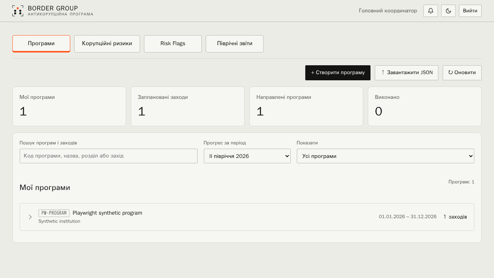

# BorderGroup - моніторинг виконання антикорупційної програми

Команда **BorderGroup** · [Завдання 2: цифрова система моніторингу виконання антикорупційної програми](https://hack.bitec.com.ua/zavdannia-2/)
Cклад команди:
- `@demid21cher - капітан`;
- `@Morphess`;
- `@kaschenko179`;
- `@bzena434-collab`.

## Проблема і користувачі

Виконавці заходів, уповноважені особи та керівники працюють з даними антикорупційної програми, розкиданими між таблицями, документами й окремими звітами. Через це важко швидко побачити відповідального, строк, стан виконання та підтвердження результату. BorderGroup розробляє єдиний простір для ведення програми й заходів, щоб зменшити ручне зведення даних і зробити історію змін простежуваною. Прототип використовує лише синтетичні дані організаторів.

## Що робить рішення

Поточна реалізація у гілці `main`:

- Зберігає структуру програми, її розділи, заходи та пов’язані сутності в PostgreSQL.
- Надає API для входу, користувачів, програм, розділів і заходів.
- Перевіряє доступ до програм, заходів, документів і звітів за роллю та підрозділом.
- Застосовує версійні міграції схеми БД через Alembic.
- Перевіряє HTTP-сценарії API та міграції в GitHub Actions.



## Демонстрація

------

## Розгортання

Потрібні Git, Python 3 і Docker із Compose v2. Запуск на Linux/macOS
або Docker Desktop; порт 8001 має бути вільним. Це окремий локальний
демопроєкт із власними volumes, не конфігурація production.

1. Клонуйте проєкт:
   ```sh
   git clone https://github.com/Morphess/Anticor_monitor.git
   cd Anticor_monitor
   ```
2. Згенеруйте випадкові локальні секрети:
   ```sh
   python3 scripts/demo-init.py
   ```
3. Зберіть API та запустіть БД:
   ```sh
   docker compose -p bordergroup-demo --env-file .env.demo -f compose.yaml -f compose.demo.yaml build api
   docker compose -p bordergroup-demo --env-file .env.demo -f compose.yaml -f compose.demo.yaml up -d --wait db
   ```
4. Застосуйте міграції та створіть адміністратора порожньої демо-БД:
   ```sh
   docker compose -p bordergroup-demo --env-file .env.demo -f compose.yaml -f compose.demo.yaml run --rm --no-deps api alembic -c /app/alembic.ini upgrade head
   docker compose -p bordergroup-demo --env-file .env.demo -f compose.yaml -f compose.demo.yaml run --rm --no-deps api python -m app.services.bootstrap_demo
   ```
5. Запустіть застосунок і відкрийте http://127.0.0.1:8001/login:
   ```sh
   docker compose -p bordergroup-demo --env-file .env.demo -f compose.yaml -f compose.demo.yaml up -d --no-deps api
   curl --fail http://127.0.0.1:8001/health
   ```
   Логін — `demo_admin`, пароль — значення `DEMO_PASSWORD` у вашому
   `.env.demo`. Міграції створюють ролі ADMIN, MAIN_KOORD, KOORD, VYK і KER.
   З адміністратора створіть користувачів цих ролей; для координаторів
   і виконавців спочатку додайте синтетичний підрозділ.
   База використовує окремого demo_user лише для локальної демонстрації;
   production потребує окремих адміністративної та прикладної ролей.

ШІ необов'язкова для основного workflow. Для аналізу потрібні приблизно
4 ГБ вільної RAM додатково та завантаження моделі (~1,9 ГБ):
```sh
docker compose -p bordergroup-demo --env-file .env.demo --profile ai up -d ollama
docker compose -p bordergroup-demo --env-file .env.demo exec ollama ollama pull qwen2.5:3b
```
На CPU аналіз може тривати кілька хвилин. Інструкція production — [docs/release.md](docs/release.md).

## Побудова

**Стек:** Python 3.13, FastAPI, Jinja2, HTML/CSS/JavaScript, PostgreSQL 17, SQLAlchemy, Alembic, Docker Compose, GitHub Actions.

```text
Клієнт → FastAPI (backend/app/api) → бізнес-логіка (services)  → доступ до даних (repositories) → PostgreSQL
         HTML-шаблони й статичні файли (frontend/)
         Міграції схеми (alembic/)
```

Маршрути API підключено в `backend/app/main.py`; моделі даних лежать у `backend/app/models/`, автоматичні перевірки — у `tests/` та `.github/workflows/ci.yml`. 


## Документація

- [Використання ШІ](docs/ai.md) — інструменти, застосування та перевірка командою; записка доповнюється під час розробки.
- [PostgreSQL і розгортання](docs/database.md) — конфігурація БД, Docker Compose і доступ через Tailscale.
- [Перевірка релізу й деплой](docs/release.md) — міграція, резервні копії та команди production.
- [Базовий аудит безпеки](docs/security-review.md) — перевірки, виправлення та межі аудиту.

## Що використали

- Бібліотеки: FastAPI, Starlette, Pydantic, SQLAlchemy, Alembic, psycopg, Jinja2, Uvicorn, PyJWT, pwdlib/Argon2, Docker Compose і GitHub Actions. Точні версії Python-залежностей наведено в [`requirements.txt`](requirements.txt).
- [Синтетичний набір даних BITEC](https://hack.bitec.com.ua/wp-content/uploads/2026/11/zavdannia-2-syntetychnyi-nabir-1811daff.zip) — демонстраційні відомості; реальні персональні дані та службова інформація не використовуються.
- Інструменти ШІ та спосіб їх застосування описано в [`docs/ai.md`](docs/ai.md).

Проєкт поширюється за [ліцензією MIT](LICENSE).
