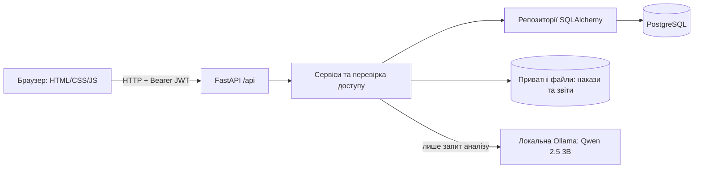

# Архітектура BorderGroup

Опис відповідає коду релізу з міграцією d2511200abcd. Це модульний
моноліт FastAPI з окремими PostgreSQL і  Ollama.

## Компоненти та джерела

| Компонент | Реалізація | Відповідальність |
|---|---|---|
| Кабінети | `frontend/templates`, `frontend/static/js` | Персональні заходи, рішення координатора, панель керівника, звіти |
| Маршрути | `backend/app/main.py`, `backend/app/api` | HTTP, валідація, JWT та рольові залежності |
| Бізнес-правила | `backend/app/services` | Призначення, подання, погодження, розрахунок сигналів і звітів |
| Доступ до даних | `backend/app/repositories` | Параметризовані SQLAlchemy-запити з обмеженням видимості |
| Модель і міграції | `backend/app/models`, коренева `alembic/` | Зв'язки, обмеження цілісності та оновлення схеми |
| Запуск | `compose.yaml`, `Dockerfile` | API від UID 10001, БД і приватні volumes |

## Ролі та життєвий цикл

ADMIN веде облікові записи, підрозділи та реєстр наказів. MAIN_KOORD
створює програму й заходи та направляє програму підрозділам. KOORD
призначає виконавців і погоджує або відхиляє їхні подання. VYK подає
виконання власного заходу за півріччя. KER переглядає панель, сигнали
та рекомендації у доступній гілці підрозділів. 

Подання Execution зберігає виконавця, період і точну версію наказу.
Погодження не є спільним для всіх виконавців заходу. Сервер перевіряє
видимість заходу, підрозділ та версію документа; UI не є межею захисту.
Оновлення номера або версії документа потребує повторної перевірки.

## Як система формує висновки

- `risk_flag_services.py`: явні правила RF1–RF7e та RF8 (строки,
  підтвердження, показники, пояснення й номер наказу). Для незавершеного
  періоду доступність правил обмежена; не всі сигнали виникають у real time.
- `management_dashboard_services.py`: операційні строки, прогрес і
  рекомендації з кодом, підставою, пріоритетом та пропозицією дії.
  Це правила сервісу, а не згенеровані Qwen рішення.
- `risk_assessment_services.py`: оцінка ризику за ймовірністю та наслідками;
  завершені оцінки захищено також тригером БД.
- `report_generation_service.py`: повторне використання виконань у
  піврічному звіті з трьома розділами. Поточний період позначається
  попереднім; непогоджені та неповні дані не приховуються.
- Qwen дає допоміжне порівняння наказу із заходом і не змінює погодження.

## Зберігання і межі довіри

PostgreSQL містить програми, ролі, подання, показники, журнал і метадані
звітів. Файли наказів — `/app/storage/orders`; JSON-снапшоти звітів і
тексти ШІ — `/app/storage/reports` (аналізи в підкаталозі `analyses`).
Вони не публікуються як статика. Висновок прив'язаний до подання,
версії/SHA-256, змісту заходу, правил і параметрів моделі.

JWT має строк дії, паролі хешуються Argon2. Доступ до БД і Ollama —
усередині Compose; на хості API типово доступний лише на 127.0.0.1:8001.
Для командного сервера використовується Tailscale Serve; локальному
демо він не потрібен. Це не атестація для обробки службової інформації.

## Перевірка і обмеження

На коді 9e2187c пройшли 109 Python-тестів і 9 Playwright-сценаріїв;
окремо відтворено чистий запуск і створення всіх активних ролей через API.
Автотести не оцінюють якість справжньої моделі й не покривають усі
комбінації бізнес-даних. Черги довготривалих ШІ-завдань, горизонтальної
реплікації файлового сховища та конекторів МОУ/НАЗК немає.
Для розвитку потрібні спільне приватне сховище, керування ключами,
централізований аудит і погоджені контракти інтеграції.
