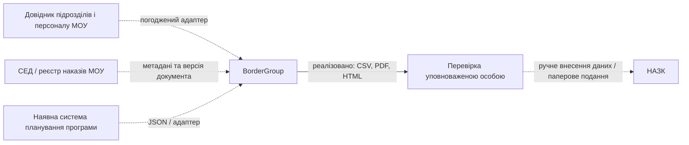

# Карта інтеграції з системами МОУ та НАЗК

**Статус:** зараз реалізовано внутрішній REST API, імпорт JSON програми
та експорт звіту. Автоматичних підключень до систем МОУ або НАЗК немає.
Наведені нижче відомчі джерела — категорії для погодження з власниками,
а не твердження про доступність конкретного API чи укладені угоди.

## Дані та напрямки

| Джерело / одержувач | Які дані | Стан зараз | Що потрібно погодити |
|---|---|---|---|
| Довідник організаційної структури МОУ | Код, назва, parent_id підрозділу | ADMIN створює довідник у BorderGroup | Стабільні зовнішні ID, власник довідника, періодичність синхронізації |
| Система ідентичностей / кадровий довідник | Обліковий запис, роль, підрозділ | Локальні користувачі й JWT; SSO немає | Провайдер ідентичності, мапінг ролей, мінімізація персональних даних |
| СЕД або реєстр наказів | Номер, дата, версія, файл і контрольна сума | Авторизований реєстр і приватне файлове сховище | Право читання, класифікація документа, незмінний зовнішній ID версії |
| Реєстр програм / система планування | Програма, розділи, заходи, строки, показники | `POST /api/program-import/`: валідований JSON; основні довідники мають існувати | Формат перетворення, дублікати, джерело істини та контроль конфліктів |
| Портал доброчесності НАЗК | Піврічний звіт: три розділи, фактичний строк, стан, результат або пояснення | CSV, PDF і HTML; перевірка та перенесення людиною | Чинна форма, порядок подання, можливість офіційного API — лише якщо його надасть НАЗК |
| Відомчий архів / аудит | Перевірений звіт, ID версії, журнал подій | Локальні файли, записи журналу й резервні копії | Строки зберігання, доступ, централізований незмінний архів |

## Вбудовування як модуля

API та вебінтерфейс можуть бути розгорнуті в контурі наявної системи
за окремим reverse proxy. Це план вбудовування, а не готова інтеграція:
потрібні SSO/сервісна авторизація, TLS, узгодження URL, CORS і прав,
мапінг зовнішніх ID та журналювання викликів. Сервер повторно перевіряє
доступ; роль, передана клієнтським адаптером, сама по собі не є доказом прав.

## Відповідність полям НАЗК

`report_generation_service.py` і `schemas/report_portal.py` формують:

- три розділи програми й заходи в них;
- запланований і фактичний строк, стан виконання;
- опис результату або пояснення причин невиконання;
- окремий стан «Строк виконання заходу не настав»;
- для постійних заходів — фактичну дату за правилами звітного півріччя.

Це підготовка даних у структурі завдання, **не сертифікація сумісності
з імпортом Порталу**. CSV не завантажується туди автоматично. Перед
реальним поданням людина перевіряє поля та чинний порядок. Для обмежених
даних завдання передбачає друковану форму; сам MVP перевірений лише на
синтетичних даних і не має дозволу на роботу зі службовими документами.

## План перевірки майбутнього адаптера

1. Погодити власника даних і письмовий контракт на синтетичних прикладах.
2. Перевірити ID, ієрархію, одиниці показників, версії й часові межі.
3. Зробити read-only імпорт у тестовий контур і звірити кількість записів.
4. Відтворити дубль, відмову доступу, зміну версії та відновлення після збою.
5. Дозволити виробничий обмін лише після приймання власником системи.

Джерело: [Завдання 2 — формат звіту та інтеграція](https://hack.bitec.com.ua/zavdannia-2/).
